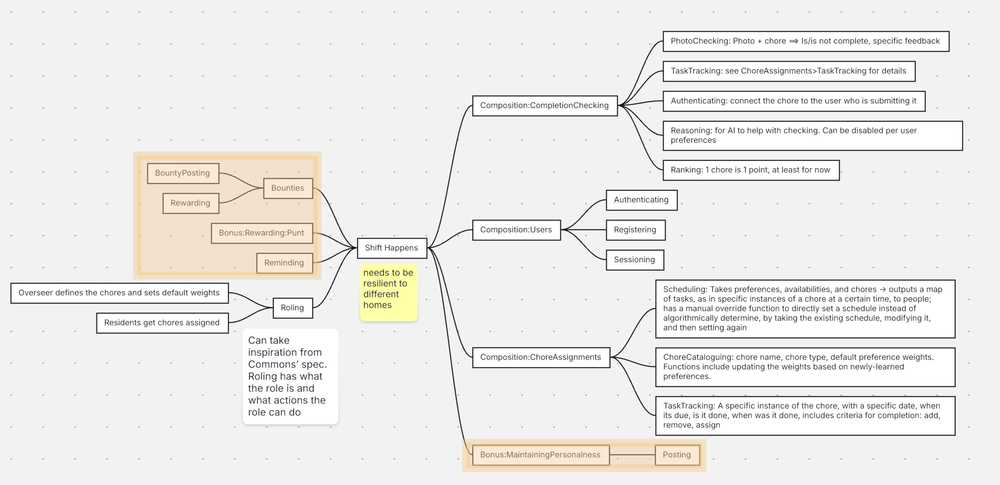

# Concepts that make up *Shift Happens*

The overall design of *Shift Happens* is visualized in the below concept map, where concepts and compositions connect to *Shift Happens* in the center. Prose explanations follow.

## Core features 

The problem of **unclear assignments** and **uneven responsibilities** are addressed through the `ChoreAssignments` composition. Chores are populated into the `ChoreCataloguing` concept by the Overseer, along with how frequently they need to be done and the overseer's assessment of how preferred that chore is at large. Users' availabilities and chore preferences, along with the overall list of chores from `ChoreCataloguing`, are used by `Scheduling` in order to determine a satisfactory distribution of chores for the household. The option for users to submit their own chore preferences helps them get a chore that is less taxing for them, but if they do not submit preferences, the defaults set by the Overseer will be used. `ChoreCataloguing` and `Scheduling` will split a chore into specific tasks, stored by `TaskTracking`, that have a data and can be completed.

`CompletionChecking` is the composition that primarily addresses the problem of **tedious chore verification**. Given a task and a photo, `PhotoChecking` is used to prompt the Overseer or agent to verify that the chore is in fact completed. (`Reasoning` is how that agent interacts with the `PhotoChecking` concept.)

After a chore is completed, the assigned user is given a point in `Ranking`. `Ranking` then allows *Shift Happens* to display a leaderboard based on all accumulated points by a user in a household.

References above to "the Overseer" are designated by `Roling`.  `Roling` defines which users are Overseer(s) of the household versus standard residents, and which actions can be taken by these roles.

## Bonus features

The orange boxes on the concept map represent second-priority features. If the other features are working, we will add:

`Reminding` to notify users if the deadline for their chore is approaching and it is still incomplete.

`Rewarding` would include household-determined rewards, such as extra rank or a discount on utilities (for example), to users who complete a particular set of chores or a quantity of chores.

`Bounties`, which are like making a pact between users to do extra chores, combine either rewards from `Rewarding` with chore completion, or two users' chore completion together. For example, Alice can post a bounty saying, "I will wash all the dishes if someone will clear all the drying racks before I get home at 6pm." `BountyPosting` tracks the bounty's creation and progress, and `Rewarding` associates any additional rewards to it.

`Posting` is another bonus concept that would allow a Venmo-like feed for residents to view and react to each others' chores. This is meant to diminish the impersonal nature of a chore-tracking app over accountability via human interaction, and promote gratitude within the community.

# Potential issues

The biggest remaining issue we have is balancing chores of disparate effort, such as when one person may be assigned two chores and others are assigned only one. Depending on how much time the core features end up taking, the weights of a chore that represents how much effort it takes will be adjusted to vary by chore, and `Ranking` and `Scheduling` will consider this when updating and balancing, respectively.
