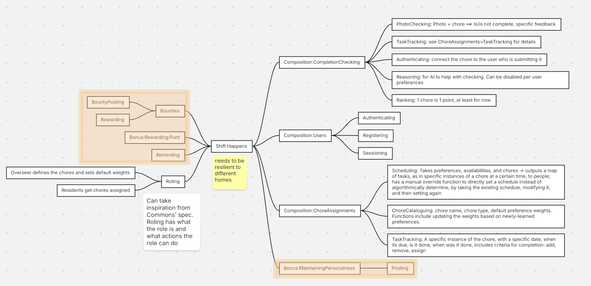

# Concepts that make up *Shift Happens*

The concept map shows the original design for *Shift Happens*, including planned concepts such as `Roling`.

## Core features

Organization is taken care of through the `Households` composition, which uses the `HouseholdManaging` concept, whereby overseers can register and manage their household, and users can register as residents for their households. `HouseholdManaging` keeps track of household data, like its overseer and household work categories, as well as resident data, such as their preferences these categories. Users have the option to submit their own preferences to get assigned chores more comfortable for them, otherwise the defaults wil be used. 

The problem of **unclear assignments** and **uneven responsibilities** within a household are addressed through the `ChoreAssignments` composition. Chores are populated into the `ChoreCataloguing` concept by the Overseer, along with how frequently they need to be done and the overseer's assessment of how preferred that chore is at large. `TaskScheduling` keeps track of users' availabilities, and combines chore categories and resident preferences from `HouseholdManaging` along with the overall list of chores and their difficulty weights from `ChoreCataloguing` in order to determine a fair distribution of chores for the household. While `ChoreCataloguing` manages the canonical list of chores and their requirements, `TaskScheduling` has the responsibility of creating instances of chores as tasks with associated time intervals, assigning them accordingly, and marking their completion. Based on the specific chore type, tasks might float based on deadlines instead of specific intervals.

`CompletionChecking` is the composition that primarily addresses the problem of **tedious chore verification**. Given a task and a photo, `PhotoChecking` is used to prompt the Overseer or agent to verify that the chore is in fact completed. (`Reasoning` is how that agent interacts with the `PhotoChecking` concept.)

After a chore is completed, the assigned user is given a point in `Ranking`. `Ranking` then allows *Shift Happens* to display a leaderboard based on all accumulated points by a user in a household.

In alpha, the overseer runs automatic assignment for a selected week from **Manage → Assign available residents**. A scheduled Sunday-night run is a possible Beta extension.

`HouseholdManaging` records household membership and one overseer per household. The compositions use that record to check which actions each person can take. `Roling` is a possible Beta extension for more granular permissions.

## Bonus features

The orange boxes on the concept map represent second-priority features. If the other features are working, we will add:

`Reminding` to notify users if the deadline for their chore is approaching and it is still incomplete.

`Rewarding` would include household-determined rewards, such as extra rank or a discount on utilities (for example), to users who complete a particular set of chores or a quantity of chores.

`Bounties`, which are like making a pact between users to do extra chores, combine either rewards from `Rewarding` with chore completion, or two users' chore completion together. For example, Alice can post a bounty saying, "I will wash all the dishes if someone will clear all the drying racks before I get home at 6pm." `BountyPosting` tracks the bounty's creation and progress, and `Rewarding` associates any additional rewards to it.

`Posting` is another bonus concept that would allow a Venmo-like feed for residents to view and react to each others' chores. This is meant to diminish the impersonal nature of a chore-tracking app over accountability via human interaction, and promote gratitude within the community.

# Potential issues

The biggest remaining issue we have is balancing chores of disparate effort, such as when one person may be assigned two chores and others are assigned only one. Depending on how much time the core features end up taking, the weights of a chore that represents how much effort it takes will be adjusted to vary by chore, and `Ranking` and `Scheduling` will consider this when updating and balancing, respectively.
